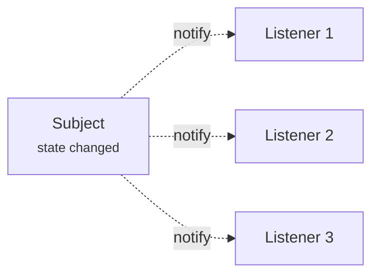

// Behavioral · 2 of 3

# 🟣 Observer

> 🔴 **PROBLEM** 
> Tight coupling to know about changes

> 🟢 **BENEFIT** 
> One change notifies many listeners

---

⬅️ [Strategy](Strategy.md) · ➡️ [Command](Command.md)
