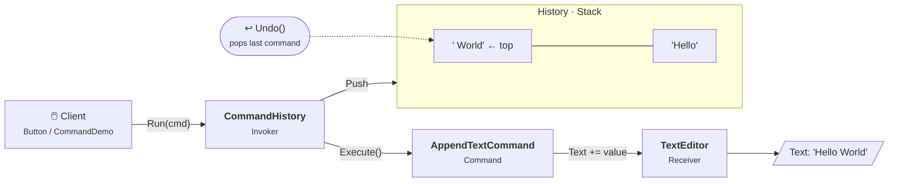

# 🟣 Reference
[Command Design pattern "refactoring.guru"](https://refactoring.guru/design-patterns/command)

# 🟣 Command

*Turn an action into an object, so you can run it, store it and undo it.*

> 🔴 **PROBLEM** 
> Actions hard-wired to the UI

> 🟢 **BENEFIT** 
> Queue, log and undo actions

## Roles

| Role | Class | Job |
|---|---|---|
| Command | `ICommand` / `AppendTextCommand` | Wraps one action with `Execute()` and `Undo()` |
| Receiver | `TextEditor` | Does the real work |
| Invoker | `CommandHistory` | Runs commands and keeps a stack for undo |
| Client | `CommandDemo` (or a button) | Creates commands and passes them to the invoker |

## How it runs
| Step | Call | History stack | Editor text |
|---|---|---|---|
| 1 | `Run("Hello")` | Hello | `Hello` |
| 2 | `Run(" World")` | Hello, **World** (top) | `Hello World` |
| 3 | `Undo()` | Hello | `Hello` |

## Watch the video

---

⬅️ [Observer](Observer.md) · ➡️ [Summary](../Summary.md)
