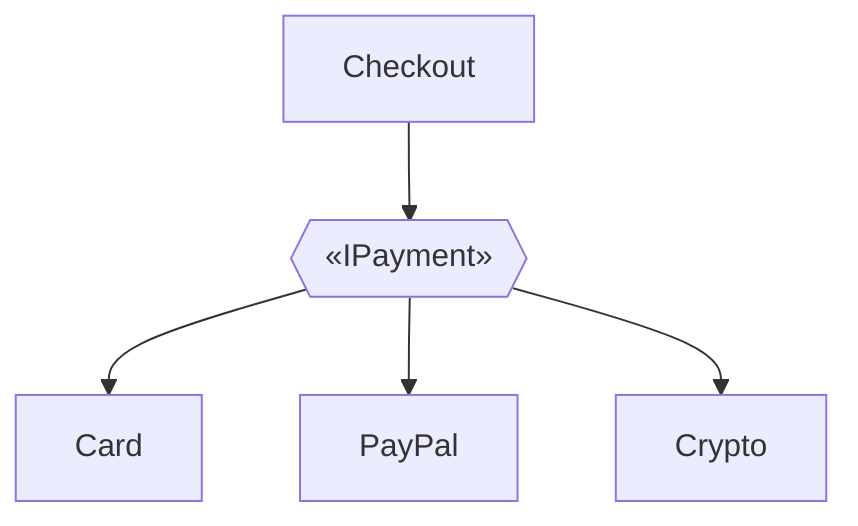

// Behavioral · 1 of 3

# 🟣 Strategy

> 🔴 **PROBLEM** 
> A growing if / else chain

> 🟢 **BENEFIT** 
> Swap behavior without editing code

---

⬅️ [Behavioral](Behavioral.md) · ➡️ [Observer](Observer.md)
