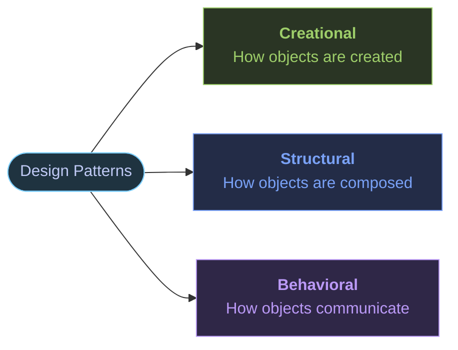
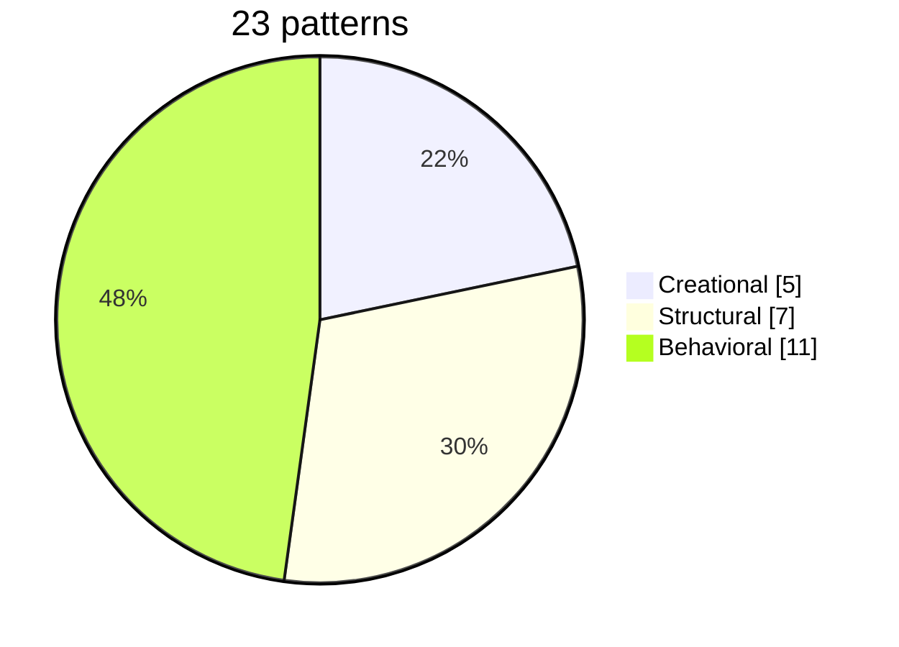

# 3 categories

*Grouped by the kind of problem they solve.*

| | Category | Focus |
|---|---|---|
| 🟢 | **Creational** | How objects are **created** |
| 🔵 | **Structural** | How objects are **composed** |
| 🟣 | **Behavioral** | How objects **communicate** |

---

## How many patterns?

*The Gang of Four catalogue.*

| Category | Count | |
|---|---:|---|
| 🟢 Creational | 5 | █████ |
| 🔵 Structural | 7 | ███████ |
| 🟣 Behavioral | 11 | ███████████ |
| **Total** | **23** | |

---

⬅️ [README](README.md) · ➡️ [Behavioral](/Behavioral/Behavioral.md.md)

