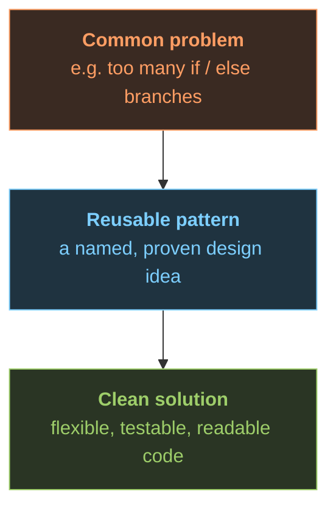

# Design Patterns

> A high-level visual tour · **23 proven solutions · 3 categories**

`🟢 Creational` · `🔵 Structural` · `🟣 Behavioral`

---

## What is a design pattern?

*A named, reusable answer to a common problem.*

# Problem → Pattern

*A quick cheat sheet.*

| Problem | Pattern |
|---|---|
| Need exactly one instance | 🟢 [Singleton](./Creational/Singleton/Singleton.md) |
| Complex object setup | 🟢 [Builder](./Creational/Builder/Builder.md) |
| Incompatible interfaces | 🔵 [Adapter](./Structural/Adapter/Adapter.md) |
| Add features without subclasses | 🔵 [Decorator](./Structural/Decorator/Decorator.md) |
| Too many if / else branches | 🟣 [Strategy](./Behavioral/Strategy/Strategy.md) |
| React to changes | 🟣 [Observer](./Behavioral/Observer/Observer.md) |

---

# 3 categories · 23 patterns

| 🟢 Creational | 🔵 Structural | 🟣 Behavioral |
|:---:|:---:|:---:|
| **Create** | **Compose** | **Communicate** |
| 5 patterns | 7 patterns | 11 patterns |

> ### Don't reinvent — reuse proven solutions.

---

**Not ready-made code: a proven design idea.**

Catalogued by the "Gang of Four" (1994)

---

➡️ Next: [Categories](Categories.md)
