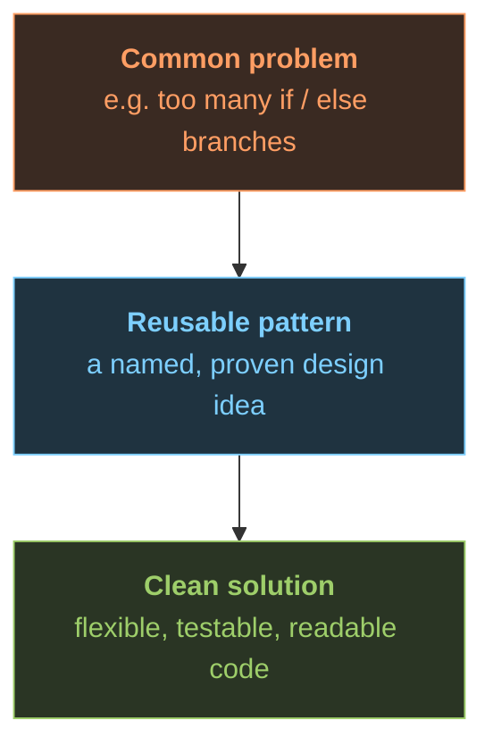
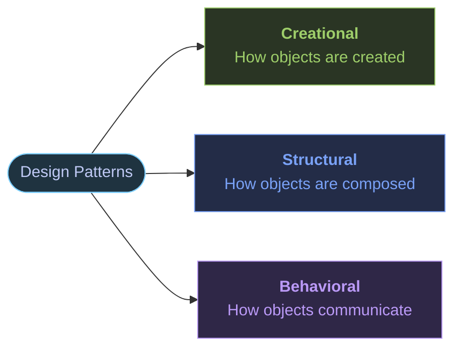
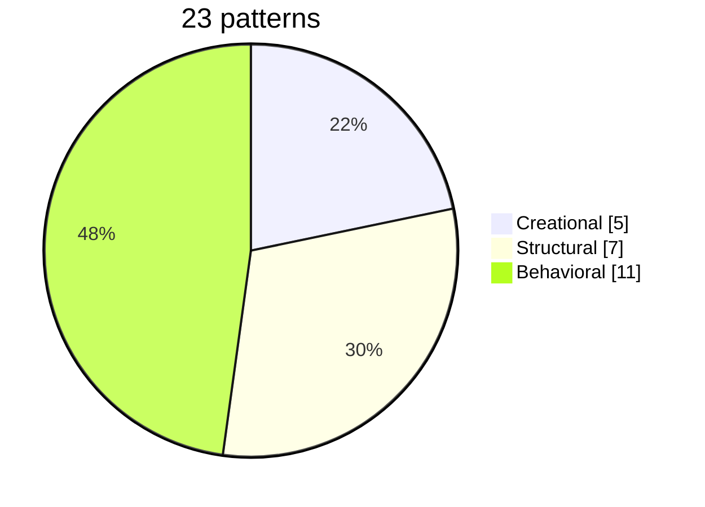

# Design Patterns

> A high-level visual tour · **23 proven solutions · 3 categories**

`🟢 Creational` · `🔵 Structural` · `🟣 Behavioral`

---

## What is a design pattern?

*A named, reusable answer to a common problem.*

# 3 categories · 23 patterns

| 🟢 Creational | 🔵 Structural | 🟣 Behavioral |
|:---:|:---:|:---:|
| **Create** | **Compose** | **Communicate** |
| 5 patterns | 7 patterns | 11 patterns |

> ### Don't reinvent — reuse proven solutions.
*Grouped by the kind of problem they solve.*

| | Category | Focus |
|---|---|---|
| 🟢 | **Creational** | How objects are **created** |
| 🔵 | **Structural** | How objects are **composed** |
| 🟣 | **Behavioral** | How objects **communicate** |

---

## How many patterns?

*The Gang of Four catalogue.*

| Category | Count | |
|---|---:|---|
| 🟢 Creational | 5 | █████ |
| 🔵 Structural | 7 | ███████ |
| 🟣 Behavioral | 11 | ███████████ |
| **Total** | **23** | |

---

# Problem → Pattern

*A quick cheat sheet.*

| Problem | Pattern |
|---|---|
| Need exactly one instance | 🟢 [Singleton](./Creational/Singleton/README.md) |
| Complex object setup | 🟢 [Builder](./Creational/Builder/README.md) |
| Incompatible interfaces | 🔵 [Adapter](./Structural/Adapter/README.md) |
| Add features without subclasses | 🔵 [Decorator](./Structural/Decorator/README.md) |
| Too many if / else branches | 🟣 [Strategy](./Behavioral/Strategy/README.md) |
| React to changes | 🟣 [Observer](./Behavioral/Observer/README.md) |

**Not ready-made code: a proven design idea.**

Catalogued by the "Gang of Four" (1994)

---

➡️ Next: [Categories](Categories.md)
