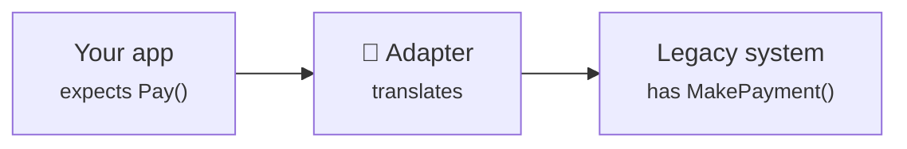

// Structural · 1 of 3

# 🔵 Adapter

> 🔴 **PROBLEM** 
> Interfaces don't match

> 🟢 **BENEFIT** 
> Reuse old code without changing it

---

⬅️ [Structural](Structural.md) · ➡️ [Decorator](Decorator.md)
