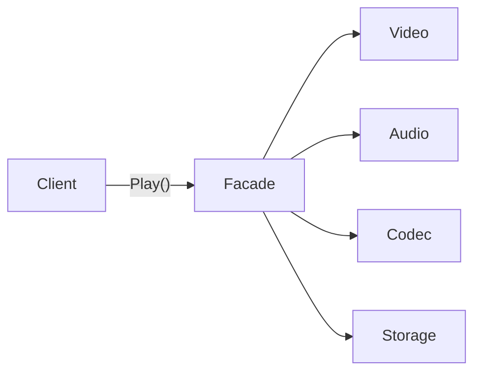

// Structural · 3 of 3

# 🔵 Facade

> 🔴 **PROBLEM** 
> A complex subsystem is hard to use

> 🟢 **BENEFIT** 
> One simple entry point

---

⬅️ [Decorator](Decorator.md) · ➡️ [Behavioral](../Behavioral/Behavioral.md)
